<div align="center">

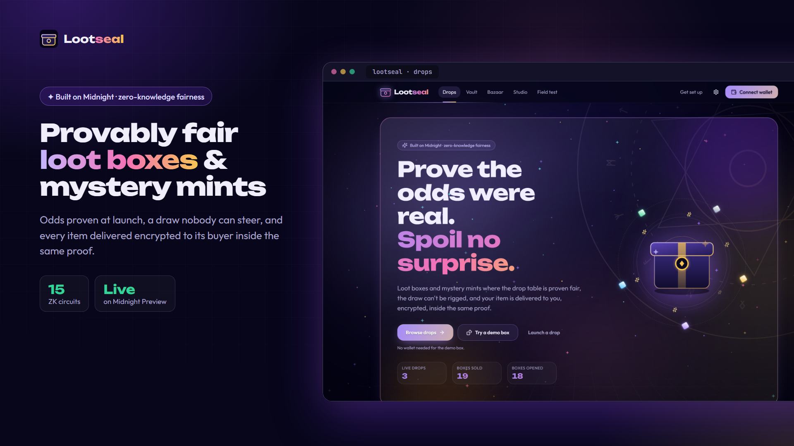

<h1>Lootseal</h1>

<h3>Prove the odds were real. Spoil no surprise.</h3>

<p>A fairness layer for loot boxes, gacha pulls and NFT mystery mints, built on <a href="https://midnight.network">Midnight</a>.<br/>
Odds proven in zero knowledge · randomness nobody controls · items delivered sealed to their buyer.</p>

<a href="https://lootseal.vercel.app"></a>
<a href="#-deployed-on-midnight-preview"></a>
<a href="#-field-test-used-for-real-on-preview"></a>

<a href="apps/lootseal/contract"></a>
<a href="https://docs.midnight.network"></a>


<a href="#-testing"></a>
<a href="LICENSE"></a>

<br/><br/>

<a href="#-why-lootseal"><b>Why</b></a> ·
<a href="#-how-it-works"><b>How it works</b></a> ·
<a href="#-architecture"><b>Architecture</b></a> ·
<a href="#-workflow-and-lifecycle"><b>Workflow</b></a> ·
<a href="#-app-tour"><b>App tour</b></a> ·
<a href="#-field-test-used-for-real-on-preview"><b>Field test</b></a> ·
<a href="#-try-it-in-5-steps"><b>Try it</b></a> ·
<a href="#-run-locally"><b>Run locally</b></a>

<br/><br/>

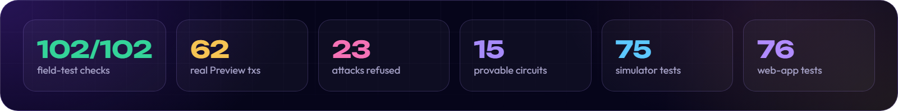

</div>


## ✦ Why Lootseal

Games and NFT launches publish odds ("1% legendary") that nobody can check. Insiders snipe rare items before a reveal, and bots time purchases for when the rares are left. Regulators are pushing back:

- **China and South Korea** require loot-box probability disclosure. South Korea's rules have been in force since 2024.
- **Apple and Google** require odds disclosure in their app stores.
- **Belgium** treats paid loot boxes as gambling.

Publishing the whole drop table isn't the answer either. It spoils the surprise and hands bots a map. Lootseal uses Midnight's public/private split to give players **verifiable odds without revealing the table**.

<table>
<tr>
<td width="50%" valign="top">

🟡 **Odds proven at launch**<br/>
<sub><code>commitTable</code> proves in zero knowledge that the hidden per-item counts sum, per tier, to the advertised totals. Only the tier totals are public.</sub>

🟣 **A draw nobody can steer**<br/>
<sub>The roll for box <i>k</i> is <code>persistentHash(masterSeed, buyerSeed, k)</code>. The master seed is committed before the sale, and the buyer picks their own seed.</sub>

🔵 **Nothing to snipe**<br/>
<sub>Remaining supply is a salted commitment, re-committed after every open, so every box carries exactly the advertised chance.</sub>

🔴 **No withholding**<br/>
<sub>Boxes open strictly FIFO within <code>fulfillWindow</code>. After that, <code>claimRefund</code> pays the price plus a penalty from the publisher's bond, and the drop is marked <b>DEFAULTED</b> forever.</sub>

</td>
<td width="50%" valign="top">

🟢 **Only the buyer learns the item**<br/>
<sub><code>openBox</code> encrypts the item to the buyer's Jubjub key (Diffie-Hellman), and the same proof binds the ciphertext to the item commitment.</sub>

🟠 **Rarity without disclosure**<br/>
<sub><code>proveRarityTier</code> publishes "tier ≤ T" for an item the caller owns. Its type and serial stay private.</sub>

🟣 **Private gifting and trade**<br/>
<sub><code>transferItem</code> re-encrypts an item to a new owner. The bazaar escrows NIGHT, and the contract delivers the item to the buyer's keys itself.</sub>

🟡 **Public audit**<br/>
<sub><code>finalReveal</code> opens the table, and <code>verifyOdds</code> lets anyone re-check it on chain. The master seed is never revealed.</sub>

</td>
</tr>
</table>

Residual risks are stated honestly in [docs/THREAT_MODEL.md](docs/THREAT_MODEL.md).


## ✦ How it works

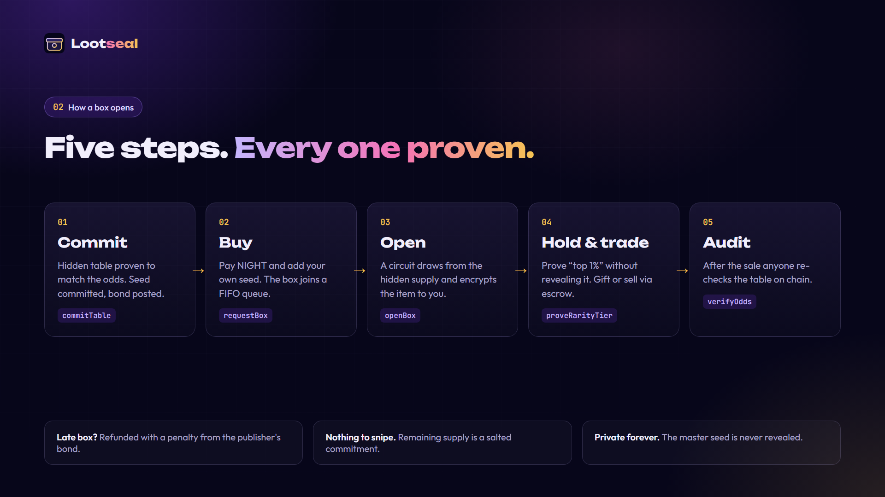

| | Step | What happens | Circuit |
|:-:|---|---|---|
| 🟣 | **Commit** | The publisher commits a hidden drop table and proves it matches the advertised odds. The master seed is committed and a bond is posted. | `commitTable` · `commitSeed` |
| 🩷 | **Buy** | The buyer pays NIGHT and adds their own secret seed. The box joins a FIFO queue with a deadline. | `requestBox` |
| 🟡 | **Open** | A circuit draws from the hidden remaining supply and encrypts the item to the buyer, all in one proof. | `openBox` |
| 🔵 | **Hold & trade** | Holders prove "top 1%" without revealing the item, gift privately, or sell through escrow. | `proveRarityTier` · `transferItem` · `listItem` |
| 🟢 | **Audit** | After the sale, the table is opened and anyone can re-check it on chain. | `finalReveal` · `verifyOdds` |


## ✦ Architecture

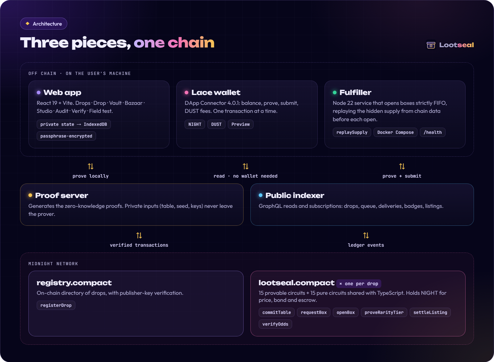

<details>
<summary><b>Text version</b></summary>

```
 Lootseal web app (React 19 + Vite) ──── Lace (DApp Connector 4.0.1): balance · prove · submit · DUST fees
   Drops · Drop · Vault · Bazaar · Studio · Audit · Verify · Field test
   private state: IndexedDB, passphrase-encrypted (levelPrivateStateProvider)
        │ reads: public indexer (no wallet needed)        │ writes: one tx at a time
        ▼                                                  ▼
 ┌──────────────────────────── Midnight ─────────────────────────────┐
 │ registry.compact            lootseal.compact (one per drop)        │
 │  drops (verified entries)    public: catalog, tier odds, price,     │
 │                              commitments, queue, item commitments,  │
 │                              ciphertexts, badges, listings, NIGHT   │
 │                              private (only in provers): per-item    │
 │                              counts, remaining supply, master seed, │
 │                              owner/enc keys, item openings          │
 └────────────────────────────────────────────────────────────────────┘
        ▲
 Fulfiller (Node 22 + wallet-sdk + proof server): opens boxes FIFO, replaying the
 hidden supply from chain data before each open (contract/lib.ts replaySupply)
```

</details>

### Midnight's dual ledger

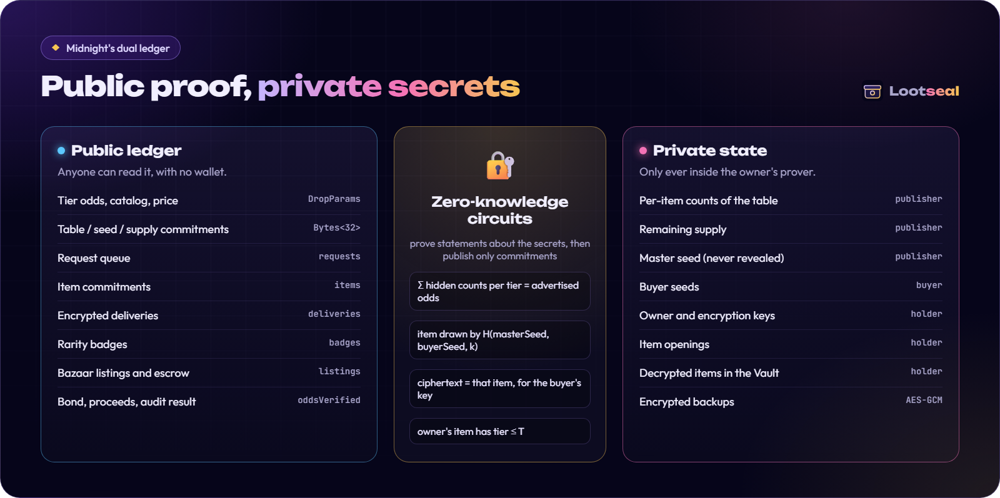

- **Witness-checked work:** the roll reduction (`divMod64`) and the item pick (`pickType`) are computed off chain and verified in circuit, so a lying witness only makes the call fail.
- **Never index a ledger field with a secret.** The catalog and supply vectors are always read whole and selected in-circuit with `fold`/`map`.
- **Unshielded NIGHT** flows through `receiveUnshielded` and `sendUnshielded`: price, bond, penalty, escrow, refunds and proceeds.

### Contracts and circuits

| | Contract | Circuits |
|:-:|---|---|
| 🩷 | [`lootseal.compact`](apps/lootseal/contract/lootseal.compact)<br/><sub>one per drop</sub> | `commitTable` `commitSeed` `requestBox` `openBox` `claimRefund` `proveRarityTier` `transferItem` `listItem` `buyListing` `settleListing` `cancelListing` `refundListing` `claimProceeds` `finalReveal` `verifyOdds`<br/><sub>plus 15 pure circuits shared with TypeScript: <code>rollOf</code>, <code>itemCommit</code>, <code>deliveryMask</code>, <code>sharedPoint</code>, …</sub> |
| 🟣 | [`registry.compact`](apps/lootseal/contract/registry.compact)<br/><sub>on-chain directory</sub> | `registerDrop` |

### Engineering highlights

| | | |
|:-:|---|---|
| 🧱 | **Staged deploy** | Deploying all 15 provable circuits at once exceeds the per-block `bytes_written` budget. [`staged-deploy.ts`](apps/lootseal/contract/staged-deploy.ts) deploys the 4 launch circuits first, then installs the other 11 verifier keys with signed maintenance updates (`VerifierKeyInsert`), 4 per transaction. An interrupted launch resumes from chain state. |
| ⚡ | **First sync in minutes** | The public indexer streams ledger events to one subscription at about 6 per second, which is about 12 hours for the DUST stream. [`indexer-cache.mjs`](apps/lootseal/scripts/indexer-cache.mjs) pulls both streams over parallel subscriptions and serves them locally. With it, the deployer synced in **12 minutes**. |
| ♻️ | **A fulfiller that holds no state** | [The fulfiller](apps/lootseal/fulfiller/README.md) rebuilds the hidden supply from chain data before every open, so it can restart anywhere. It ships with Docker Compose, a health endpoint and retry with backoff. |

Full design: [docs/ARCHITECTURE.md](docs/ARCHITECTURE.md) · Contract card: [apps/lootseal/SPEC.md](apps/lootseal/SPEC.md)


## ✦ Workflow and lifecycle

### One box, end to end

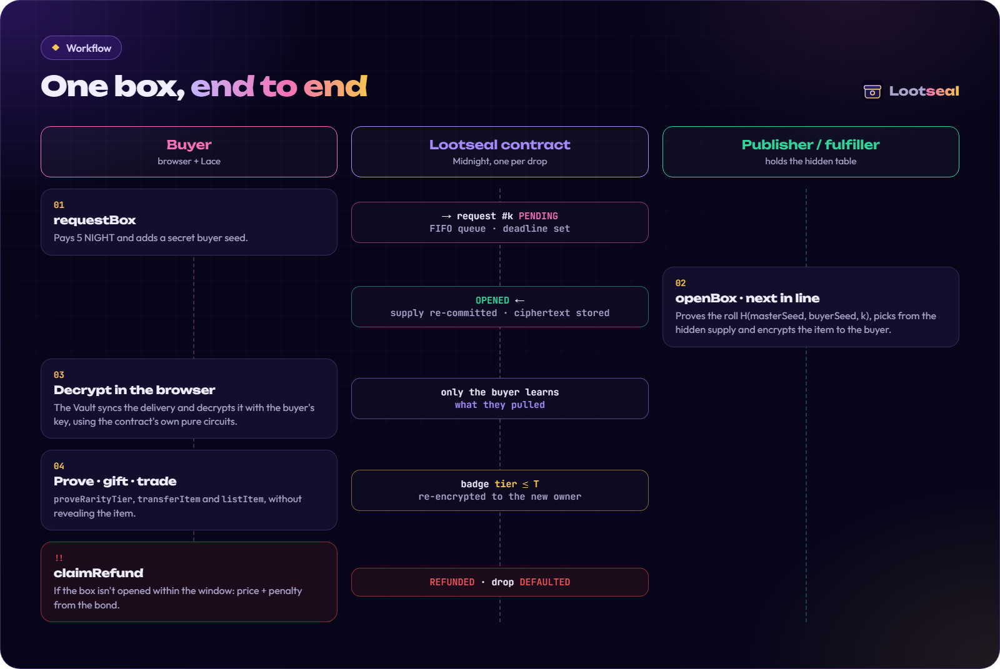

### Drop lifecycle

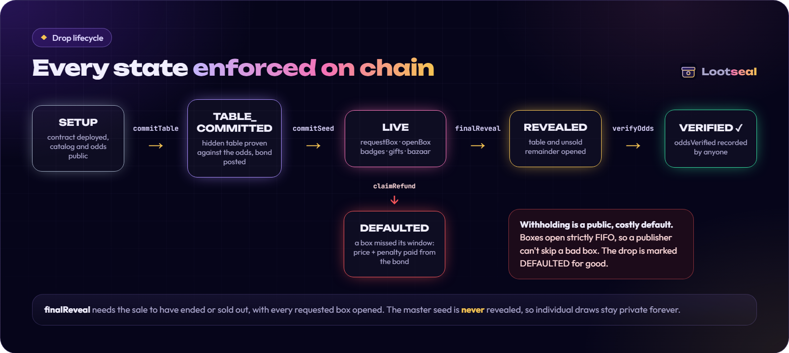

### Bazaar escrow

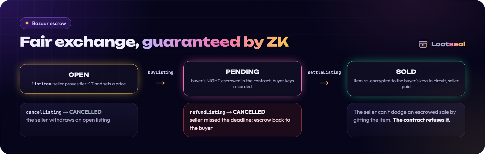


## ✦ App tour

The web app talks to Midnight through Lace. Every page that reads chain data works without a wallet. **Open it live at [lootseal.vercel.app](https://lootseal.vercel.app).**

### 🏠 Landing page

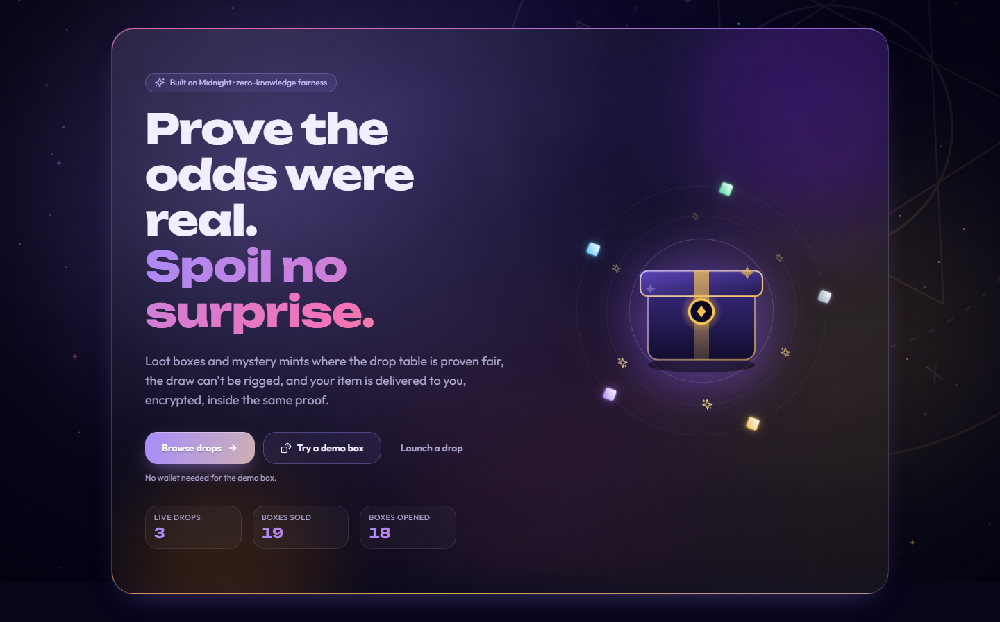

**Hero.** The pitch, live network stats read from the indexer (live drops, boxes sold, boxes opened) and three ways in: browse drops, try a **demo box** with no wallet, or launch a drop.

<table>
<tr>
<td width="50%">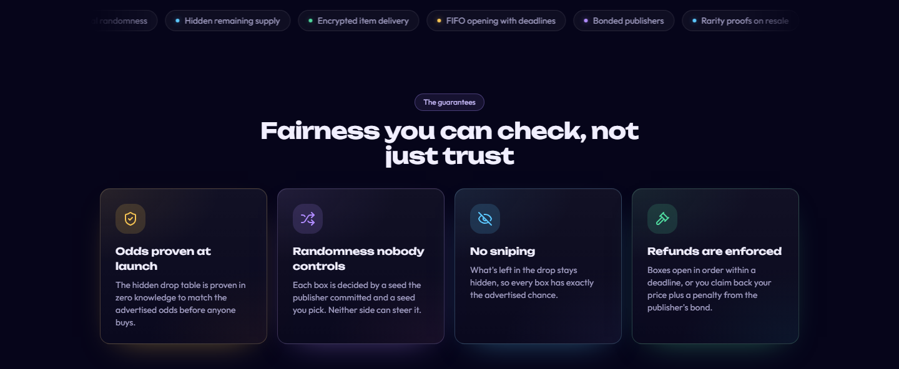<br/><sub><b>The guarantees.</b> A ribbon of everything Lootseal enforces, then its four core promises.</sub></td>
<td width="50%">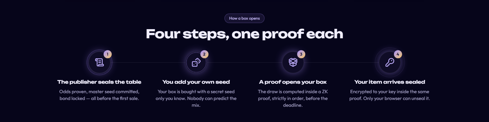<br/><sub><b>How a box opens.</b> Four steps, one proof each, from sealed table to sealed item.</sub></td>
</tr>
<tr>
<td width="50%">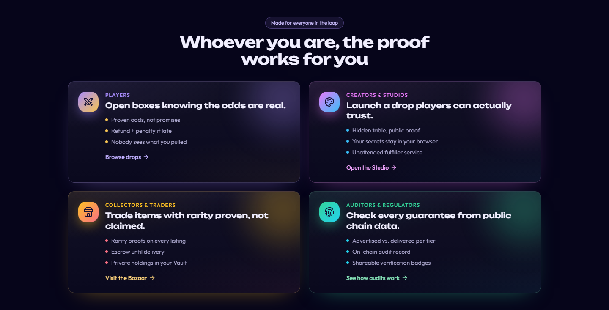<br/><sub><b>Who it's for.</b> Players, creators, collectors and auditors, each linked to the part of the app built for them.</sub></td>
<td width="50%">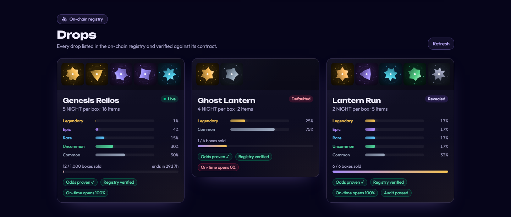<br/><sub><b>Drops.</b> Every drop in the on-chain registry, verified against its contract, with trust badges.</sub></td>
</tr>
</table>

### 🎁 Demo box

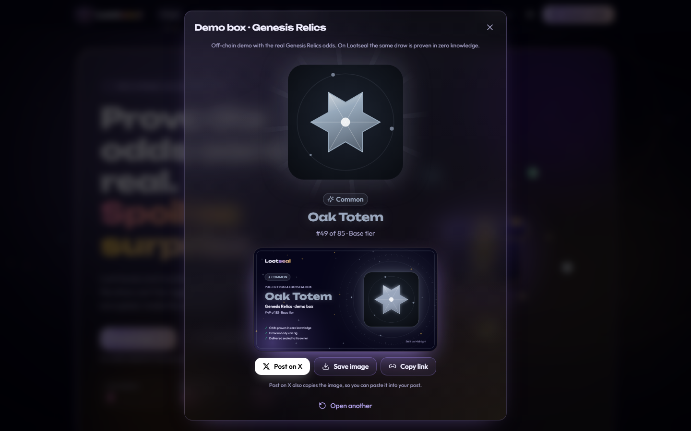

A free, off-chain opening with the real Genesis Relics odds, so anyone can feel the reveal before installing a wallet. Every pull renders a 1200×675 **share card**: *Post on X* copies the image and opens a ready-made post, and phones share it natively.

### 💎 Drop page

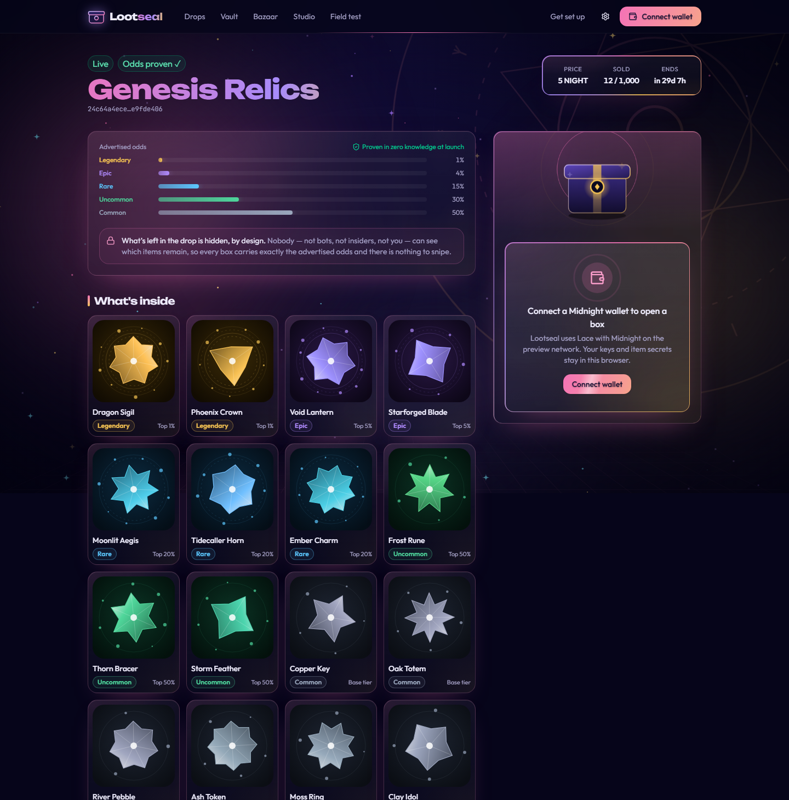

The heart of the app. It shows the advertised odds with the **"Proven in zero knowledge at launch"** mark, a reminder that the remaining supply is hidden by design, and the full catalog with procedural item art and tier ranks. A stepper takes the buyer through *Pay & seed → Sealed* (with queue position and refund countdown) *→ Reveal*. **Claim refund + penalty** appears only after the deadline. The trust record below shows boxes opened, late refunds, the bond left and the table commitment.

### 🔐 Vault

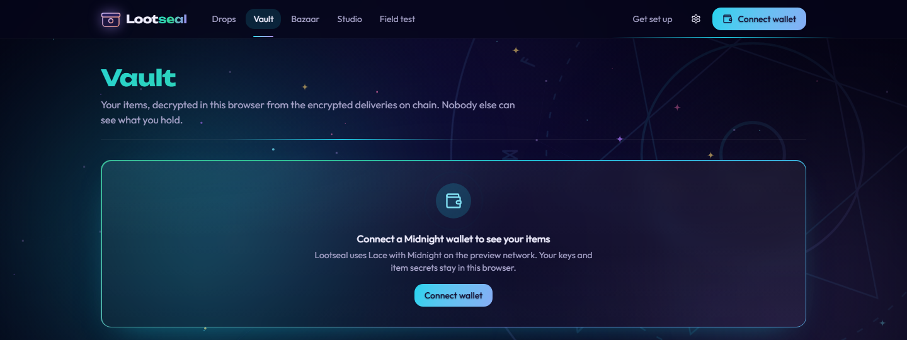

Your items, decrypted **in this browser** from the encrypted deliveries on chain, so nobody else can see what you hold. From here you can prove rarity badges, gift by Lootseal ID, list on the Bazaar, and back up your keys to a passphrase-encrypted file.

### ⚖️ Bazaar

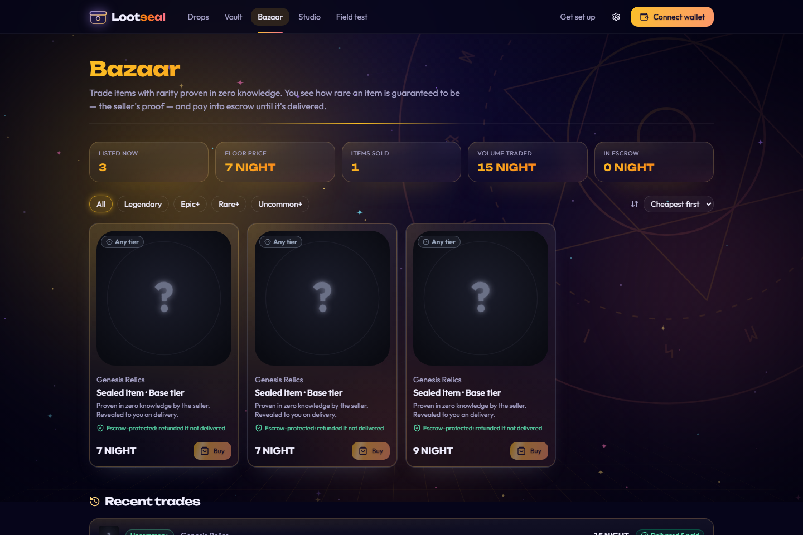

Trade items with rarity **proven**, not claimed. Listings show their proven tier bound, and the buyer's NIGHT sits in escrow until the contract delivers the item. If the seller doesn't settle, the buyer is refunded after the deadline. The page also shows market stats and recent trades.

### 🛠️ Studio

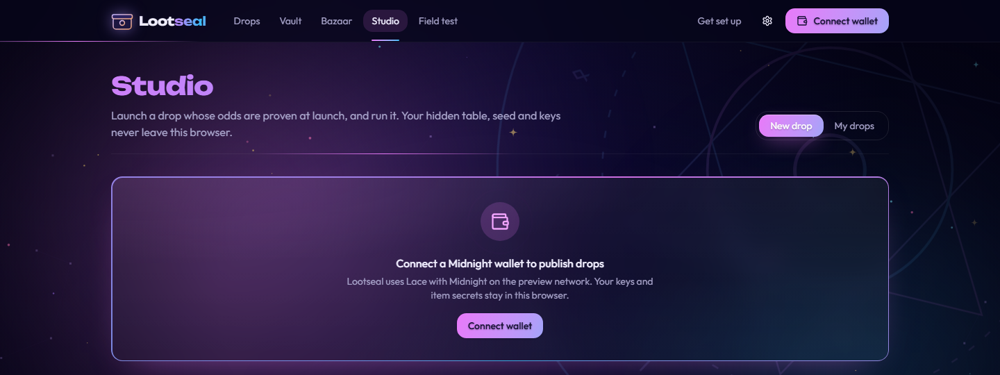

Launch a drop whose odds are proven at launch, then run it.
- **Wizard:** builds the catalog and tiers with a live odds preview.
- **Launch steps:** the staged deploy, the odds proof, the seed commitment, the bond and the registry entry.
- **Dashboard:** opens boxes.

Your hidden table, seed and keys never leave the browser.

### 🔎 Audit

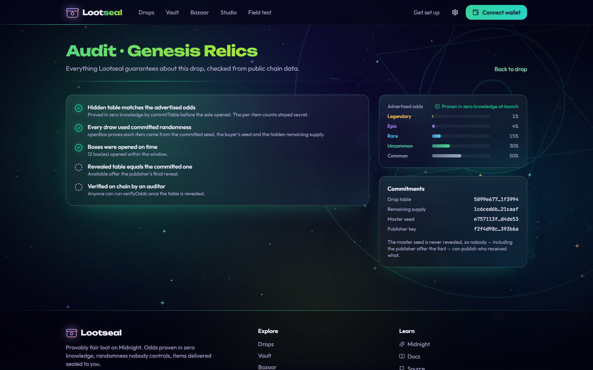

Everything Lootseal guarantees about a drop, checked from public chain data:
- the odds proof
- committed randomness
- on-time opens
- the revealed table against the committed one
- the on-chain `verifyOdds` record

Rarity badges get a shareable `#/verify/…` page.

### 🧪 Field test

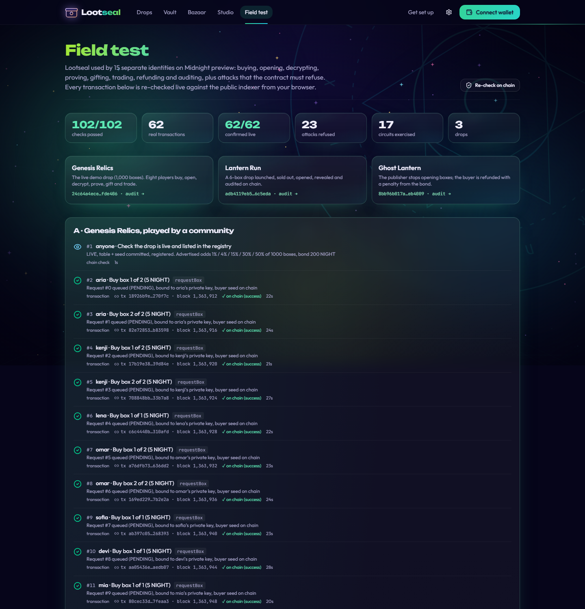

A public journal of Lootseal used for real on Preview. **Re-check on chain** confirms each of its transactions against the public indexer from your browser.


## ✦ Field test: used for real on Preview

Beyond the test suites, Lootseal was **used** on Midnight Preview by 15 separate identities, each with its own keys and private state. Every step was checked against the chain afterwards.

| 🟢 Checks | 🟡 Transactions | 🩷 Attacks refused | 🟣 Circuits | 🔵 Drops |
|:-:|:-:|:-:|:-:|:-:|
| **102/102** | **62** (62/62 confirmed live) | **23** | **17** exercised | **3** |

| Story | What happened on chain |
|---|---|
| 🩷 **A · Genesis Relics, played by a community** | 8 players bought 12 boxes, and the publisher opened all 12 strictly in order. Each player decrypted only their own pulls (all 12 deliveries were cross-checked against all 8 keys). The run also produced 3 rarity badges, one of them **Legendary**, plus a gift by Lootseal ID and 5 bazaar listings with proven bounds. One listing was cancelled, an escrowed sale settled end to end, and proceeds were withdrawn. |
| 🟡 **B · Lantern Run, launched → sold out → revealed → audited** | A fresh staged deploy, odds proof, bond, seed and registry entry. 6 buys sold it out and 6 FIFO opens followed. A seller missed the escrow deadline and the buyer was refunded. `finalReveal` published the table and `verifyOdds` recorded **TRUE** on chain. |
| 🔴 **C · Ghost Lantern, a publisher who never opens** | The buyer waited out the window, then `claimRefund` returned the price **plus a 3 NIGHT penalty from the bond**. The drop is marked DEFAULTED for good. |

<details>
<summary><b>🛡️ The 23 attacks the contract refused</b></summary>
<br/>

Opening boxes without publisher secrets, or with forged ones · a clock 2 hours off · opening an empty queue · refunding an opened box, early, or twice · claiming a Legendary badge for a lower-tier item · moving, cancelling or reselling an item **while knowing its full plaintext opening** but not the owner key · listing twice or overstating rarity · buying a cancelled listing · dodging an escrowed sale by gifting the item · pulling escrow early · getting paid twice · stealing the publisher's proceeds · re-registering a drop · overselling a sold-out drop · revealing early · buying from a finished drop · opening after a default.

</details>

To run it yourself: `MIDNIGHT_NETWORK=preview LOOTSEAL_STATE_STORE=<deploy store> yarn workspace @lootseal/app field-test` ([`scripts/field-test.ts`](apps/lootseal/scripts/field-test.ts)). The public journal is [`deployments/preview-field-test.json`](apps/lootseal/deployments/preview-field-test.json). Who pulled which item stays private.


## ✦ Deployed on Midnight Preview

| | Contract | Address |
|:-:|---|---|
| 🟣 | Drop registry | `9a50e32ce590446b1c0eef5a5c0e0bf6897bbbc79b11975716d935d452b9eca3` |
| 🩷 | **Genesis Relics** (demo drop) | `24c64a4eceaeb7f810bd6ca6812e8af9ad82ad1fa476491e8cfd6741e9fde406` |

Genesis Relics is live: 1,000 boxes at 5 NIGHT, proven in zero knowledge at launch, with a fulfiller opening bought boxes automatically. Full record: [`deployments/preview.json`](apps/lootseal/deployments/preview.json).

| Tier | Odds | Boxes |
|---|:-:|:-:|
| 🟡 Legendary | 1% | 10 |
| 🟣 Epic | 4% | 40 |
| 🔵 Rare | 15% | 150 |
| 🟢 Uncommon | 30% | 300 |
| ⚪ Common | 50% | 500 |

## ✦ Try it in 5 steps

1. Install [Lace](https://www.lace.io) with Midnight and switch it to **Preview**.
2. Fund the wallet from the [Preview faucet](https://midnight-tmnight-preview.nethermind.dev/). In Lace, designate the NIGHT for DUST and wait a few minutes.
3. Open **[lootseal.vercel.app](https://lootseal.vercel.app)**, click **Connect wallet**, and choose a passphrase for your encrypted vault.
4. Open **Genesis Relics** and click **Open a box**. When the publisher's proof lands, the reveal plays and the item appears in your **Vault**.
5. In the Vault, **Prove rarity** and follow the `/verify` link, **List** the item on the **Bazaar**, or launch your own drop in the **Studio**. The **Audit** page shows every guarantee.

> 💡 No wallet? Click **Try a demo box** on the landing page.


## ✦ Run locally

Requirements: WSL2 or Linux/macOS, Node 22, Docker, and the Compact toolchain (`compact update 0.31.1`).

```bash
corepack enable
yarn install
yarn compile                 # both contracts, with ZK keys
yarn test:sim                # in-memory simulator tests (no network)
yarn test:ui                 # web-app unit tests
yarn env:up                  # local node + indexer + proof server (compose.yml)
yarn test:local              # devnet end-to-end suite (real proofs)
yarn dev                     # web app on http://localhost:5173 (Lace on "Undeployed")
```

If ports 9944, 8088 or 6300 are taken, set `LOOTSEAL_NODE_PORT`, `LOOTSEAL_INDEXER_PORT` and `LOOTSEAL_PROOF_PORT`. Set `LOOTSEAL_SAFE_JIT=1` for long devnet runs on machines that hit V8 optimizer crashes.

- **Deploy contracts:** run `MIDNIGHT_NETWORK=preview yarn deploy`. It creates and funds a deployer wallet (printing the address for the faucet), deploys the registry and Genesis Relics, launches the drop, and writes `deployments/preview.json` plus an encrypted publisher bundle under `.secrets/` (gitignored). An interrupted launch resumes with `RESUME_REGISTRY`, `RESUME_DROP` and `LOOTSEAL_STATE_STORE`.
- **Deploy the web app:** run `yarn build`, then serve `apps/lootseal/ui/dist` (it includes the ZK keys and `vercel.json`).
- **Fulfiller:** see [apps/lootseal/fulfiller/README.md](apps/lootseal/fulfiller/README.md) (Docker Compose: proof server + fulfiller).

## ✦ Testing

| | Suite | Count | What it covers |
|:-:|---|:-:|---|
| 🔵 | Simulator · `yarn test:sim` | **75** | Every circuit; a rejection test for every reachable `assert`, including lying witnesses; privacy invariants after every phase; an exact-table check on a sold-out drop; a chi-square test that every box position is equally likely to hold the legendary |
| 🟣 | Devnet end-to-end · `yarn test:local` | **14+** | Real proofs, NIGHT payments, refunds, escrow, and the fulfiller running unattended |
| 🩷 | Web app · `yarn test:ui` | **76** | Components, routing, private state, providers, the field-test journal |
| 🟢 | Field test on Preview | **102/102** | 15 identities, 62 real transactions, 23 refused attacks |

CI runs compile, typecheck, simulator tests, UI tests and the build on every push.


## ✦ Design system

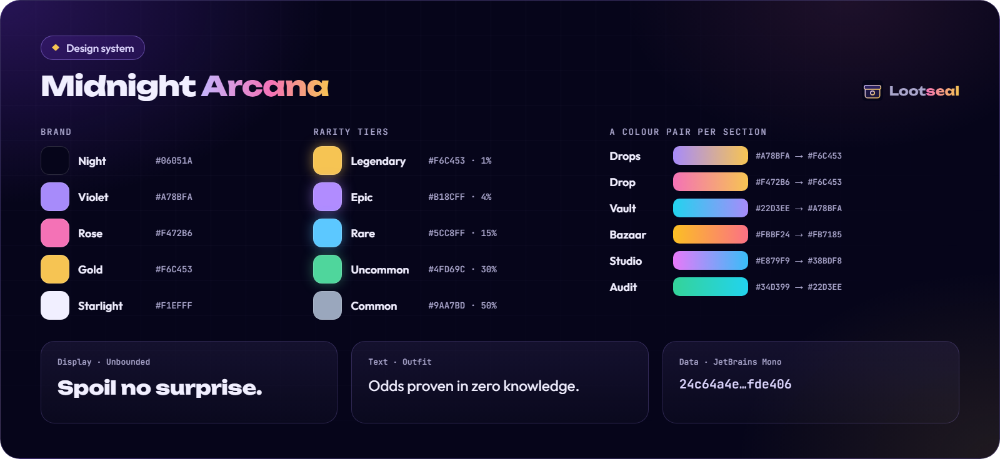

The app's "Midnight Arcana" theme takes the logo's violet and gold. Every section has its own colour pair, every rarity tier has a glow, and the type is Unbounded, Outfit and JetBrains Mono. The backdrop is animated, and it stays static for users who prefer reduced motion.

## ✦ Project structure

```
apps/lootseal/
├── contract/        lootseal.compact · registry.compact · witnesses · lib · staged deploy
├── src/test/        simulator, devnet and fulfiller suites
├── fulfiller/       box-opening service (Docker Compose)
├── scripts/         deploy · field test · indexer cache
├── deployments/     Preview addresses and the public field-test journal
└── ui/              React 19 + Vite web app
packages/            Midnight harness packages (coins, fast-sync, sim)
docs/                architecture · threat model · plan · video script · deck · diagrams · screenshots
```

## ✦ Roadmap

- [ ] **Threshold seed keepers:** an independent auditor co-commits the master seed, which removes the self-dealing residual risk
- [ ] **Shielded-token purchases**, so buying is private too
- [ ] **Provable pity timers** and guaranteed-drop rules
- [ ] **Multi-box packs** in one proof
- [ ] **Anonymous holder badges** using a Merkle tree with nullifiers
- [ ] **A cross-drop publisher reputation registry**
- [ ] **A Unity / Godot SDK**

## ✦ Attribution and license

Lootseal is licensed under **Apache-2.0** ([LICENSE](LICENSE)). The harness packages under `packages/`, the build scripts under `scripts/` and the generated UI plumbing come from Midnight Foundation's [midnight-examples](https://github.com/midnightntwrk/midnight-examples) (Apache-2.0); see [NOTICE](NOTICE). Built with Compact 0.31.1, Midnight.js 4.1.1, wallet SDK 1.2.0 and the DApp Connector API 4.0.1.


<div align="center">


**Lootseal** · provably fair loot on Midnight

Built for the **Midnight Buildathon** on Akindo

<sub><code>midnightntwrk</code> · <code>compact</code> · <code>zero-knowledge</code> · <code>privacy</code> · <code>loot-box</code> · <code>gacha</code> · <code>nft</code> · <code>provably-fair</code></sub>

</div>
